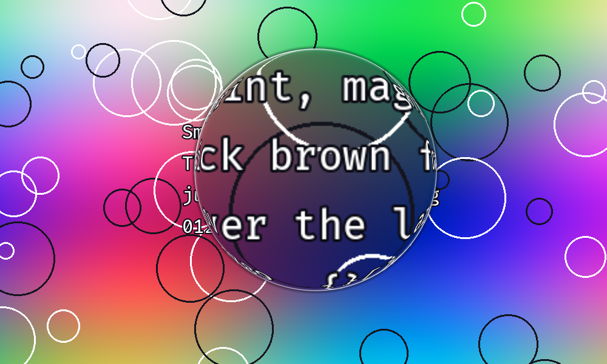
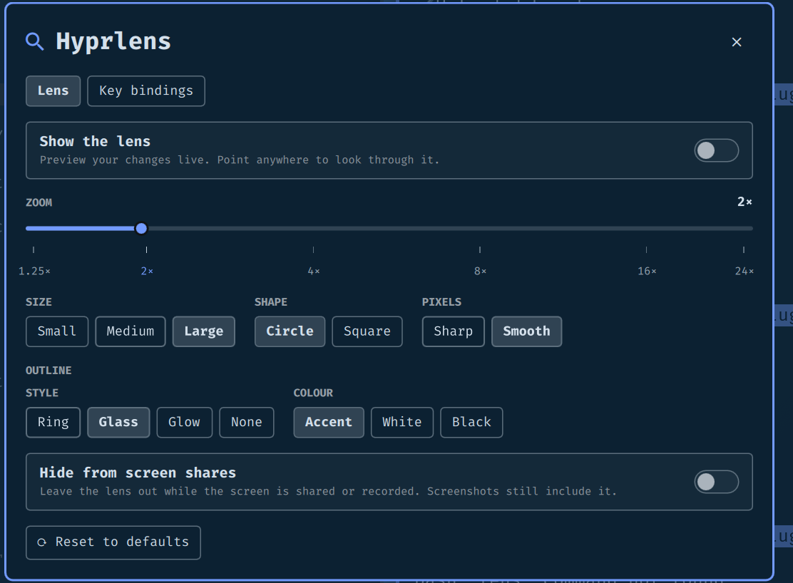
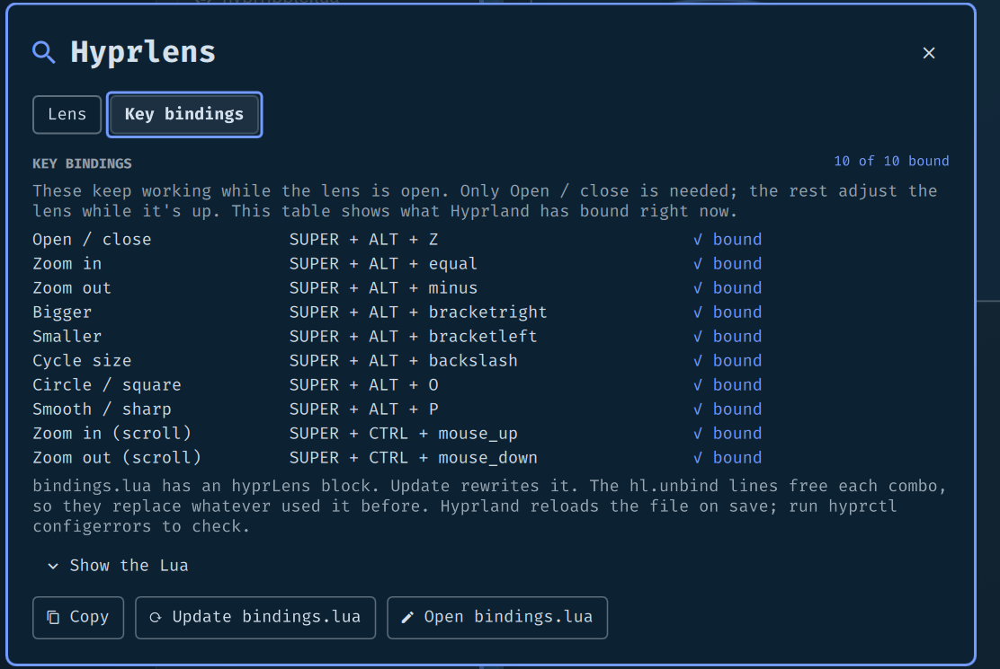
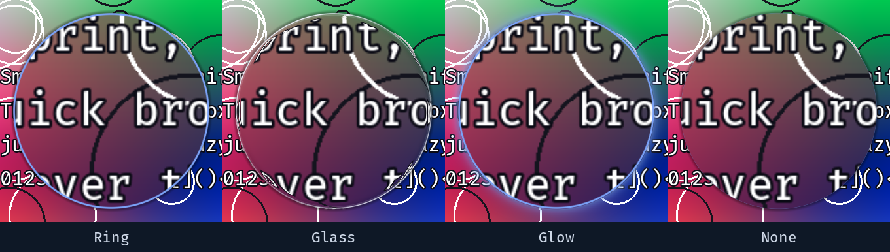
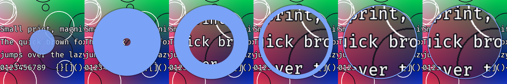

# hyprlens

A live magnifying lens for Hyprland, centered on the pointer like the zoom lens in macOS and
Windows. It is drawn by the compositor itself, so it never magnifies itself, stays live, and
asks for no frames of its own when nothing on screen changes.



- **Live and centered.** The lens sits on the pointer and shows a magnified, live view of what is
  under it. Near a screen edge it slides back on screen and a crosshair marks the pointer's spot.
- **Four outline styles.** Ring, Glass, Glow and None, in your theme's accent, white or black.
- **A settings window** for zoom, size, shape, pixels, the outline, and the key bindings, with
  full keyboard control.
- **Zoom from the keyboard or the scroll wheel** (`SUPER + CTRL + scroll`), once you add the key
  bindings from the settings window.
- **Respects reduced motion.** If you turned Hyprland animations off, it fades instead of animating.

**Status: 0.1.** Written and tested on Hyprland 0.56.2 with the Lua config (a nested instance for
rotation, scale and two monitors, and a live 4K session). Rough edges are listed under
[Limits](#limits).

## Install

Needs Hyprland 0.56+ with the Lua config, Omarchy (for the settings window and menu rows), and
to build the native plugin: `g++` (C++23), `make`, `pkg-config`, the Hyprland development files,
and `python3`. The settings window's **Copy** button uses `wl-copy` (`wl-clipboard`).

```sh
omarchy plugin add https://github.com/jgarza9788/hyprlens.git --enable
~/.config/omarchy/plugins/jgarza.hyprlens/extras/install.sh
```

`extras/install.sh` builds `hyprlens.so`, loads it into the running session, enables the
settings overlay, and adds **Hyprlens** and **Hyprlens Settings** rows to the Omarchy menu
(`SUPER + SPACE`) plus an app-launcher entry. It is safe to run again. It does **not** edit
`hyprland.lua` or `bindings.lua`; key bindings are added only when you press a button in the
settings window.

A Hyprland plugin must match the exact Hyprland build and runs inside the compositor, so a bug in
it can crash your session. After a Hyprland update, run `extras/install.sh` again (the plugin
shows a notification when it no longer matches).

**Loading at login.** `install.sh` loads the plugin for the current session. To load it at every
login, add the repo with `hyprpm add https://github.com/jgarza9788/hyprlens` and
`hyprpm enable hyprlens`. The repo has the `hyprpm.toml` for it, but I have not run that path
end to end yet.

## Use

Open it from the Omarchy menu (`SUPER + SPACE` → **Hyprlens**), the app launcher, or:

```sh
hyprctl hyprlens toggle        # open or close the lens
```

All the commands (`bin/hyprlens` is the same thing as a short command):

```sh
hyprctl hyprlens toggle | on | off
hyprctl hyprlens zoom-in | zoom-out            # x1.25 per step, 1.25x to 24x
hyprctl hyprlens bigger | smaller | size [small|medium|large]
hyprctl hyprlens shape | smooth                # circle/square, smooth/sharp pixels
hyprctl hyprlens set zoom 4                    # zoom, size (px or a name), shape, smooth
hyprctl hyprlens set style glass               # outline: ring (default), glass, glow, none
hyprctl hyprlens set outline "#ff8800"         # accent (default), or #rrggbb
hyprctl hyprlens set capture hide              # leave the lens out while the screen is shared
hyprctl hyprlens get                           # current settings as JSON
```

The three sizes are small (250 px), medium (400 px) and large (600 px). Settings are saved to
`~/.config/omarchy/jgarza.hyprlens/settings.json` and survive restarts, whether you change them
from the window, a key binding, or `hyprctl`.

## Settings window

`SUPER + SPACE` → **Hyprlens Settings**, or `omarchy-shell hyprlens settings`. Two panes,
remembered between visits.



- **Lens:** zoom (a slider with tick marks; click a tick to jump), size, shape, smooth or sharp
  pixels, the outline style and colour, hiding the lens from screen shares, and **Reset to
  defaults** (with an **Undo** for a few seconds). Changes show on the lens as you make them: turn
  on **Show the lens** and look around.
- **Key bindings:** which Hyprland binds are in place, and a button that adds or updates a marked
  `-- >>> hyprLens` block in `~/.config/hypr/bindings.lua`, backing the file up first. The Lua is
  behind **Show the Lua**.



Everything works from the keyboard. `Tab` and `Shift + Tab` move between controls, `←` `→` pick a
choice in a group and `Enter` selects it. On the zoom slider `←` `→` `↑` `↓` (or `h` `j` `k` `l`)
step the zoom, `Page Up` / `Page Down` double or halve it, and `Home` / `End` jump to the ends.
`Esc` closes the window.

## Looks



- **Ring** is a solid rim in your theme's accent (the default).
- **Glass** is an Apple-style edge: a neutral rim that catches light from the top left, a little
  shade inside the edge for thickness, a faint dark hairline outside, and the view bending slightly
  in a narrow band at the edge, like the rim of a real lens. The centre, where you read, is
  untouched, and nothing is blurred or frosted. With Hyprland animations off it draws as a plain
  ring.
- **Glow** is the ring with a soft halo.
- **None** has no rim, only a soft shadow.

The colour is your theme's accent unless you pick white or black, or set any `#rrggbb` with
`hyprctl hyprlens set outline`.

The lens opens with an accent dot that grows to full size, then its ring thins out to reveal the
view while the magnification lifts to your zoom. Closing runs the same steps backwards, and
toggling mid-way reverses smoothly.



## Key bindings

The easiest way is **Add to bindings.lua** in the settings window. It writes this block (shown
here trimmed), unbinding each combo first so it replaces whatever used it before:

```lua
-- >>> hyprLens (managed by Hyprlens Settings; Update replaces this block)
local hyprlens = os.getenv("HOME") .. "/.config/omarchy/plugins/jgarza.hyprlens/bin/hyprlens"
o.bind("SUPER + ALT + Z",            "Hyprlens",               hyprlens .. " toggle")
o.bind("SUPER + ALT + equal",        "Hyprlens zoom in",       hyprlens .. " zoom-in")
o.bind("SUPER + ALT + minus",        "Hyprlens zoom out",      hyprlens .. " zoom-out")
o.bind("SUPER + CTRL + mouse_up",    "Hyprlens zoom in (scroll)",  hyprlens .. " zoom-in")
o.bind("SUPER + CTRL + mouse_down",  "Hyprlens zoom out (scroll)", hyprlens .. " zoom-out")
-- ... bigger, smaller, cycle size, circle/square, smooth/sharp
-- <<< hyprLens
```

Only the open/close binding is needed. Stock Omarchy binds four of these keys by keycode (window
resize and webcam overlay size), so the block unbinds those keycodes too. If you also use
[omaLens](https://github.com/jgarza9788/omaLens), both use the same keys: use one of the two.
The settings window finds your binds by their descriptions (`"Hyprlens"` and so on), so keep those
if you change the keys. Check that Hyprland accepted the file with `hyprctl configerrors`.

## How it works

While the lens is on, a render pass element in the compositor copies the part of the frame that
the lens samples (not the whole frame) and draws a magnified patch of it, centered on the pointer,
inside a circle or rounded square. Because the lens is drawn after the copy, it is never part of
what it magnifies, and clicks and keys go to whatever is underneath it.

When nothing on screen changes and the pointer is still, the lens asks for no frames of its own. It
redraws when the pointer moves, while it opens or closes, and whenever something else on screen
changes.

## Limits

- **It is a Hyprland plugin.** It runs inside the compositor, must match your exact Hyprland
  build, and can crash the session if it has a bug. Try it nested first if you are cautious.
- **Screenshots include the lens.** *Hide from screen shares* leaves it out while Hyprland reports
  a screen share or recording, but a one-off `grim` screenshot does not raise that signal. Only the
  share-count path was tested (simulated); a real recording was not.
- **Tested:** all eight monitor rotations and flips at scale 1 and 1.67, and two side-by-side
  monitors, in a nested Hyprland; and a live 4K session. **Not tested:** real second monitors,
  mixed refresh rates, `hyprpm` end to end.
- **Close to the screen edge** the lens is held on screen, not centered on the pointer.
- Needs Omarchy for the settings window and the menu rows. The `hyprctl hyprlens` commands work
  without it.

## Uninstall

```sh
~/.config/omarchy/plugins/jgarza.hyprlens/extras/uninstall.sh
omarchy plugin remove jgarza.hyprlens
```

`extras/uninstall.sh` unloads the plugin (and removes it from `hyprpm` if you added it there),
removes the Omarchy menu rows and the launcher entry, and tells you what it left: your saved
settings (`rm -r ~/.config/omarchy/jgarza.hyprlens`) and the `-- >>> hyprLens` block in
`~/.config/hypr/bindings.lua`, which you delete yourself.

## Developing

```sh
make          # build hyprlens.so
make test     # unit tests for the settings logic (native/src/Logic.cpp), under ASan + UBSan
hyprctl plugin load "$PWD/hyprlens.so"
hyprctl hyprlens debug frames       # frames drawn so far, and active shares
hyprctl hyprlens debug progress 0.5 # hold the open animation at a point to look at it
hyprctl hyprlens debug anim         # what the last open/close actually did
hyprctl hyprlens debug speed 240 160 # try other open/close timings (ms) without a rebuild
```

The shell does not reload plugin QML on its own: after editing `HyprLens.qml` or
`LensSettings.qml`, run `omarchy-restart-shell`. Run a nested Hyprland to try native changes
without risking your session, and give it its own `HOME` so it does not overwrite your saved
settings. `bin/hyprlens-bindings` is the helper the settings window uses to read and rewrite the
block in `bindings.lua`. See `todo.md` for what is left.

## License

MIT. See [LICENSE](LICENSE).
